<!--
  Profile README for github.com/jonsch
  GitHub strips CSS/JS from markdown, so every animation lives inside the SVGs in assets/.
  Edit the config block at the top of scripts/build-assets.mjs and run `node scripts/build-assets.mjs` to regenerate them.
-->

<!--
  Once GitHub Pages is enabled for this repo (Settings → Pages → Deploy from branch → main, /docs),
  uncomment this line to link the scroll-animated version of the page:

<a href="https://jonsch.github.io/jonsch/">✨ See the scroll-animated version of this page →</a>

-->

<picture>
  <source media="(prefers-color-scheme: dark)" srcset="assets/section-about-dark.svg">
  
</picture>

- 🧑‍💻 Full-stack engineer who likes owning the whole thing: data model, API, payments, and the UI on top
- 🛠️ Happiest in **.NET** and **TypeScript**, deployed to **Azure**, usually with Stripe wired in somewhere
- 🤖 Lately building apps around AI inference: models doing real work inside real products
- 🧩 Weakness for small, sharp tools: CLI utilities, integrations, and anything that makes a workflow one click shorter
- 💬 Ask me about shipping a SaaS MVP solo, wiring systems together, or wrangling SQL Server

  
⚡ A few more things

   

  - 📅 On GitHub since 2012
  - 🍴 Most of my public repos are forks of tools I wanted to understand, fix, or bend to my will
  - 🔒 The interesting stuff lives in private repos, so the activity graph is intentionally quiet
  - ☕ Debugging is best done with coffee and a very long stack trace

<picture>
  <source media="(prefers-color-scheme: dark)" srcset="assets/section-toolbox-dark.svg">
  
</picture>

<picture>
  <source media="(prefers-color-scheme: dark)" srcset="assets/stack-dark.svg">
  
</picture>

<picture>
  <source media="(prefers-color-scheme: dark)" srcset="assets/section-strengths-dark.svg">
  
</picture>

<table>
  <tr>
    <td width="33%" valign="top">
      <h3>🕸️ Distributed systems</h3>
      Services that stay fast and correct when the traffic, the data, and the failure modes all grow at once.
    </td>
    <td width="33%" valign="top">
      <h3>🔌 Systems integration</h3>
      Getting APIs, databases, payment providers, and legacy systems to agree with each other.
    </td>
    <td width="33%" valign="top">
      <h3>🧠 AI inference &amp; architecture</h3>
      Designing systems around model inference: picking the right model, grounding it in real data, and keeping it fast, observable, and affordable.
    </td>
  </tr>
</table>

<picture>
  <source media="(prefers-color-scheme: dark)" srcset="assets/section-now-dark.svg">
  
</picture>

<table>
  <tr>
    <td width="50%" valign="top">
      <h3>🤖 AI inference apps</h3>
      Products built around model inference: LLM-powered features, pipelines, and automations that do real work instead of demos.
    </td>
    <td width="50%" valign="top">
      <h3>🏪 Tools for small businesses &amp; solopreneurs</h3>
      Focused products that give small teams and one-person companies the leverage usually reserved for big ones.
    </td>
  </tr>
</table>

<picture>
  <source media="(prefers-color-scheme: dark)" srcset="assets/section-connect-dark.svg">
  
</picture>

  
  <!-- Drop in whichever of these you want to be public:
  
  
  
  -->

